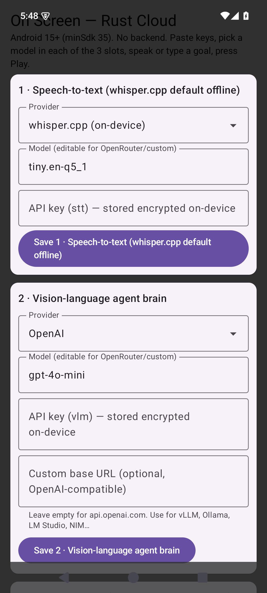
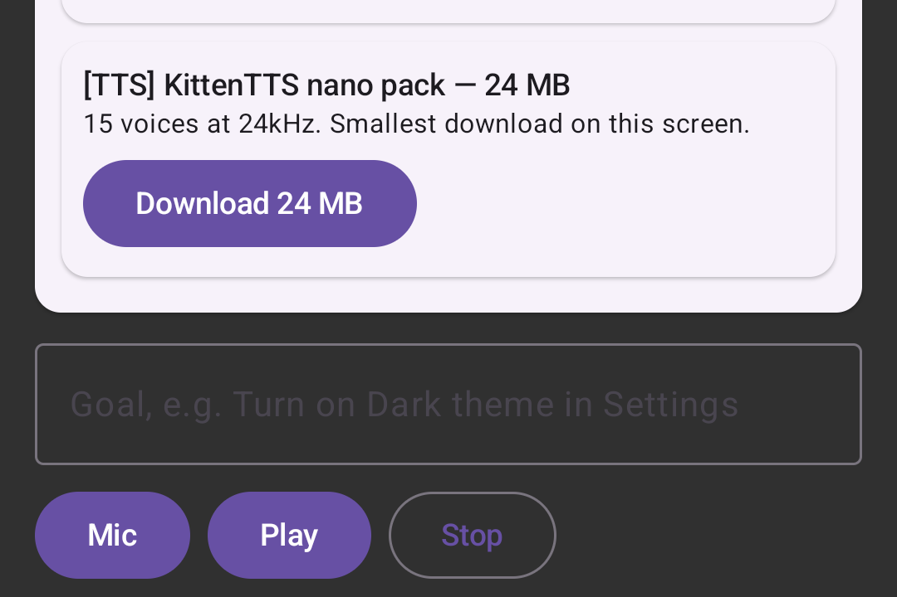

# OnScreen-Agent — Open-Source AI Agent for Android Screen Automation

**Automate your Android phone with plain English.** OnScreen-Agent is an
open-source **Android AI agent**. It looks at your screen, asks a multimodal AI
model what to do next, and then taps, types and scrolls inside your apps. It
uses the Android AccessibilityService API. Bring your own API key - no backend,
no account, no server.

<p align="center">
  <a href="#download"></a>
  <a href="https://github.com/beingDurgesh/OnScreen-Agent/releases/latest"></a>
  <a href="https://github.com/beingDurgesh/OnScreen-Agent/actions/workflows/build-apk.yml"></a>
  
  
</p>

<p align="center">
  <a href="#what-is-onscreen-agent">What it is</a> •
  <a href="#features">Features</a> •
  <a href="#how-does-it-work">How it works</a> •
  <a href="#screenshots">Screenshots</a> •
  <a href="#performance">Performance</a> •
  <a href="#download">Download</a> •
  <a href="#build-from-source">Build from source</a> •
  <a href="#faq">FAQ</a>
</p>

## Screenshots



**The three BYOK slots.** Pick a provider and a model for each, then paste your
own key.



**Type your goal, then press Play.** Mic records it for you. Stop always wins.

---

## What is OnScreen-Agent?

OnScreen-Agent is an open-source **Android AI agent** for **screen automation**
and **app automation**. You give it a goal in plain English, for example
*"turn on Dark theme in Settings"*. The agent then:

1. takes a picture of your screen,
2. reads the list of buttons and text on it,
3. asks an AI model what to do next,
4. performs that action on your phone,
5. and repeats until the job is done.

This is different from normal Android automation. Tools like Appium,
UIAutomator or Espresso follow a fixed script that you write for one screen.
OnScreen-Agent looks at whatever is on screen **right now** and picks the next
step. That means it can work on apps it has never seen before.

The app itself is small and written in Kotlin. The thinking parts — checking
actions, trimming the screen data, building the prompt — are written in Rust
and called over JNI.

It uses a **bring your own key (BYOK)** model. You paste your own OpenAI,
Google Gemini or OpenRouter API key into the app. Your key stays on your
phone, and there is no server in the middle.

> **Project status:** experimental. The app builds, the agent loop runs on an
> Android 15 emulator, and the screen capture works. But the loop has **not**
> yet run a full job against a live cloud model. Read
> [Project status](#project-status) before you trust it with anything
> important.

## Features

- **AI-powered Android automation** — turn plain-English instructions into real
  taps, typing, scrolling and navigation.
- **Screen understanding** — sends the model both a screenshot and the list of
  on-screen elements, so it can see pixels *and* structure.
- **Works with many AI models** — OpenAI (`gpt-4o-mini`, `gpt-4o`, `gpt-4.1`),
  Google Gemini (`gemini-2.5-flash`, `gemini-2.5-pro`) and any OpenRouter model.
- **Bring Your Own Key (BYOK)** — your credentials stay on your phone and your
  requests go straight to the provider. Keys are encrypted on disk.
- **Voice control** — say your goal out loud, and hear spoken status back.
- **Rust agent core** — action checking, screen-data trimming and prompt
  building all run in Rust, called from Kotlin over JNI.
- **Small and fast** — the release APK is **2.8 MB**, idle memory is **68 MB**,
  and the screen data is trimmed in Rust **4× faster** than before. See
  [Performance](#performance).
- **On-device AI is on the way** — download Whisper, Gemma 3n and KittenTTS to
  run models locally.

## How does it work?

The agent runs a simple **see → think → act** loop:

1. **You give a goal.** Type it, or say it out loud.
2. **It looks.** `AgentService` takes a screenshot with `MediaProjection`
   (JPEG, 960 px on the long side, quality 60) and reads the screen elements
   with `AccessibilityService`. Every element gets a stable id.
3. **It thinks.** The screenshot and the trimmed screen data go to your
   configured vision-language model, along with a strict list of allowed
   actions.
4. **Rust checks the answer.** `parseAction` rejects anything that does not
   fit the schema — unknown actions, too-long text, broken package names. A
   confused model cannot sneak in its own actions.
5. **It acts.** The action runs against **the same screen dump the model saw**,
   so the ids still point at the right elements.
6. **It looks again.** Then it repeats, up to **40 steps**. It stops on
   `done`, on `needHelp`, or when it hits the step limit. **Stop always
   wins** — you can halt it at any moment.

Supported actions: `click`, `longClick`, `input` (type text), `scroll`,
`back`, `home`, `openApp`, `wait`, `done`, `needHelp`.

## Performance

The app is built to stay small and quiet, because it runs on your phone next
to everything else you are doing.

### Measured numbers

| What | Measured | Target |
|---|---|---|
| Idle memory (PSS) | **68 MB** | under 180 MB |
| Release APK size | **2.8 MB** | under 25 MB |
| Debug APK size | 7.6 MB | — |
| Screen data kept | 120 elements / 8 KB | hard cap |
| Steps per run | 40 | hard cap |
| Screenshot | 960 px, JPEG quality 60 | one frame per step |

### The screen-data trim got 4× faster

The agent sends the model a small summary of the screen instead of everything
on it. Rust does that trimming. It used to read **every** element on the
screen into memory and then throw most of them away. Now it reads only the
first 120 elements and skips the rest without allocating.

| Elements on screen | Before | After | Faster by |
|---|---|---|---|
| 120 | 107 µs | 60 µs | 1.8× |
| 500 | 227 µs | 87 µs | 2.6× |
| 2 000 | 805 µs | **194 µs** | **4.1×** |

The result is byte-for-byte the same. You can check this yourself:

```bash
cd rust/agent-core
cargo run --release --example bench
```

**How much does this matter?** Less than you might think. The AI model call
takes seconds. The trimming takes microseconds. So the real win is **memory and
worst-case delay**. A big screen no longer costs thousands of short-lived
allocations, and the slowest case dropped from 1.9 ms to 0.2 ms.

### Other choices that keep it light

- Rust is compiled for size: `opt-level = "z"`, link-time optimisation, and
  symbols stripped.
- The screen list is capped at 120 elements and 8 KB.
- Only the last 6 actions are remembered, so the model never gets a long
  history.
- One screenshot per step, and every bitmap is released straight away.
- `largeHeap=false`, so the app asks Android for the normal heap size.
- ARM64 only, and the release build is shrunk and minified.

## Tech stack

| Technology | What it is used for |
|---|---|
| Kotlin | The Android app and the system APIs |
| Rust | The agent core: action checking, screen-data trimming, prompt building |
| JNI | The bridge between Kotlin and Rust (`rust/agent-core`) |
| Jetpack Compose | The app's UI |
| AccessibilityService | Reading and tapping screen elements |
| MediaProjection | Taking screenshots |
| Gradle + Cargo | Building the app and the native library |
| OpenAI API | Cloud AI, speech-to-text and text-to-speech |
| Google Gemini API | Multimodal AI and speech |
| OpenRouter | Any custom vision-language model |
| Whisper.cpp | On-device speech-to-text (in progress) |
| Gemma 3n | On-device vision-language AI (planned) |
| KittenTTS | On-device speech synthesis (in progress) |

### Why Rust and Kotlin together?

Android automation needs `AccessibilityService`, `MediaProjection`, Jetpack
Compose and runtime permissions. Those are Android framework APIs, and only
Kotlin and Java can use them. So Rust cannot do the whole app.

Rust takes the parts that run on every single step: checking actions,
trimming screen data and building the prompt. The cloud build ships no model
weights at all.

## Cloud AI and bring your own key

There is **no backend run by the developer**. The app calls your AI provider
straight from your phone, and that provider bills you.

Pick a provider and a model for each of the three slots:

| # | Slot | Providers and models |
|---|------|---------------------|
| 1 | Speech-to-text | whisper.cpp on-device (planned, not bundled) · OpenAI `whisper-1` · Gemini `gemini-2.0-flash` |
| 2 | AI brain (vision-language) | OpenAI `gpt-4o-mini` / `gpt-4o` / `gpt-4.1` · Gemini `gemini-2.5-flash` / `gemini-2.5-pro` · OpenRouter (any model) |
| 3 | Text-to-speech | KittenTTS on-device (planned, not bundled) · OpenAI `tts-1` · Gemini TTS (not finished yet) |

There is also an optional fourth field for a Brave Search key.

You can point the AI brain at any OpenAI-compatible server, such as vLLM,
Ollama or LM Studio. Leave the **Custom base URL** box empty to use
`api.openai.com`.

### On-device models (planned)

The app can already **download** on-device model packs into
`filesDir/models/<id>/`. You get a progress bar, cancel and delete. Running
them locally is the next step:

- Whisper `tiny.en-q5_1` (32 MB) and `base.en-q5_1` (60 MB)
- Gemma 3n E2B-Q8_0 (4.8 GB) and E4B-Q8_0 (7.4 GB) — both are gated, so
  approve the model on Hugging Face and save a token
- KittenTTS nano pack (24 MB)

Google does not publish Q4 builds for Gemma 3n, so the app offers Q8_0 with a
warning about RAM. Until local inference ships, these downloads are placeholders
and the functions return an error.

## Android compatibility

- **Minimum version:** Android 15 (API 35)
- **Architecture:** ARM64 (`arm64-v8a`)
- **To build it:** Android SDK 36, NDK 27, JDK 17, Rust, cargo-ndk
- **Build tools:** Gradle (app) and Cargo (native library)

## Project status

This project is still being built. Here is what has actually been tested.

**Working and tested:**

- The build pipeline works. CI is green and a signed release APK is published.
- The app installs, starts and runs on an Android 15 emulator.
- Reading screen elements works (43 elements read from a live screen).
- Taking a screenshot works (a real 43,936-byte JPEG from a live
  MediaProjection).
- Rust processes the screen data (confirmed on-device: the trimmed data comes
  back in Rust's own format).
- Action checking is covered by unit tests (15 Rust tests).
- The Rust code is 4× faster at trimming screen data, with identical output.
- Model downloads are checked against a SHA-256 before they are accepted.

**Not done or not fully tested yet:**

- A full job driven by a live cloud model on a real phone.
- How reliable it is across many different apps.
- Running the downloaded Whisper, Gemma 3n and KittenTTS models locally.
- Checking that a task really finished, and recovering when it did not.

This is an experimental project, not a finished autonomous assistant.

## Safety and privacy

OnScreen-Agent uses `AccessibilityService` and `MediaProjection` to read and
control your screen. Please keep these in mind:

- **Your screen may be sent to your AI provider.** A screenshot goes to
  whichever model you set up.
- **You pay for the API calls**, through the provider whose key you entered.
- **Your API keys are encrypted on the device**, using
  `EncryptedSharedPreferences`.
- **Some apps block automation.** Banking and wallet apps often refuse to run
  while an accessibility service is switched on.
- **Play Protect will warn you.** The app is not on Google Play, and the
  accessibility and screen-control permissions look alarming to scanners. That
  warning is expected.
- **Try it on a spare phone or a second user profile first.** The agent stops
  after 40 steps, but it can still tap things.

## Download

The latest signed release:

**→ [beingDurgesh/OnScreen-Agent releases](https://github.com/beingDurgesh/OnScreen-Agent/releases/latest)**

Direct link for the current version (2.8 MB, ARM64, Android 15+):

```
https://github.com/beingDurgesh/OnScreen-Agent/releases/latest/download/OnScreen-Agent-v0.4.2.apk
```

A `SHA256.txt` file sits next to every APK. Use it if you want to check your
download.

**How to install**

1. Download the APK.
2. On your phone open Settings → Apps → Special app access → **Install unknown
   apps**, and allow the browser or file manager you used.
3. Install the APK and open **On Screen (Rust Cloud)**.
4. Give the permissions it asks for:
   - **Accessibility** (Settings → Accessibility → On Screen) — needed to tap things.
   - **Screen capture** — needed to see the screen.
   - **Microphone** — only if you use voice goals.
5. Paste your API key, pick a model in each of the three slots, and press
   **Play**.

On Android 15 the capture permission screen has a **mode** dropdown. It starts
on *"A single app"*. Change it to **"Entire screen"**. The agent has to see
whatever app it is driving, and a single-app capture only shows one window.
Android also cancels a single-app capture of the agent's own window, which
leaves the agent unable to see anything.

## Build from source

**You need:** Android SDK 36 · Android NDK 27 · JDK 17 · Rust · cargo-ndk

```bash
git clone https://github.com/beingDurgesh/OnScreen-Agent.git
cd OnScreen-Agent
```

Build the Rust library first. It is **not** in the repository, and without it
the app quietly falls back to a slower Kotlin version:

```bash
cd rust/agent-core
export ANDROID_NDK_HOME="$ANDROID_HOME/ndk/27.0.12077973"
cargo ndk --target aarch64-linux-android --platform 35 -- build --release
mkdir -p ../../app/src/main/jniLibs/arm64-v8a
cp "$(find target -name libagent_core.so -path '*aarch64*' | head -1)" \
   ../../app/src/main/jniLibs/arm64-v8a/
cd ../..
```

Then build the APK:

```bash
./gradlew :app:assembleDebug
```

> **Note:** do not build inside a OneDrive folder. OneDrive locks Gradle's
> cache and the build dies with `Unable to delete directory
> .../app/build/kotlin/...`. Clone to a normal local folder first.

CI (`.github/workflows/build-apk.yml`) does the same steps: `cargo test` →
cargo-ndk arm64 library → `assembleDebug` → APK plus SHA-256.

### Check your build

```bash
cargo test --manifest-path rust/agent-core/Cargo.toml   # 15 Rust unit tests
cargo run --release --manifest-path rust/agent-core/Cargo.toml --example bench
python tools/check.py                                    # 55 static checks, no SDK needed
```

## FAQ

### What is an Android AI agent?

Software that reads plain-English instructions, understands what is on the
Android screen, and acts on it using supported system APIs. OnScreen-Agent
does this with multimodal AI instead of fixed scripts.

### Can OnScreen-Agent automate Android apps?

It is built to click, type, scroll and navigate through apps using
accessibility actions. How well it works still needs testing app by app, and
the loop has not yet run a full job against a live cloud model.

### Does OnScreen-Agent need an API key?

Yes, for the cloud setup. It uses bring-your-own-key: you add a key from
OpenAI, Gemini or OpenRouter and you pay for your own usage. There is no
hosted backend and no account to create.

### Which AI providers and models can I use?

OpenAI (`gpt-4o-mini`, `gpt-4o`, `gpt-4.1`) and Gemini
(`gemini-2.5-flash`, `gemini-2.5-pro`) for the AI brain. OpenRouter for any
other model. OpenAI `whisper-1` and Gemini for speech-to-text, and OpenAI
`tts-1` for text-to-speech. You can also point it at any OpenAI-compatible
server you run yourself.

### Does it work completely offline?

Not yet. The cloud setup needs an online AI provider. Downloading on-device
models (Whisper, Gemma 3n, KittenTTS) already works; running them locally is
still being built.

### What Android versions are supported?

Android 15 (API 35) and newer, on ARM64 devices.

### Is it safe to give an AI agent accessibility access?

Treat it like any automation tool that can control your screen. Try it on a
test phone or a second profile, keep an eye on the step count, and stop it if
it misbehaves. The app only talks to the AI provider you chose.

### Is OnScreen-Agent open source?

Yes. The full source, build scripts and documentation are in this public
repository under the MIT license.

### How do I build it from source?

See [Build from source](#build-from-source). You need the Android SDK 36, NDK
27, JDK 17, Rust and cargo-ndk, and you must build the Rust library before
you build the APK.

### Why is the app so small?

Because it does not bundle any AI model. The whole point of the bring-your-own-key
setup is that the heavy models run on your provider's servers, and the app on
your phone stays at 2.8 MB.

## Contributing

Contributions, bug reports, suggestions and discussions are welcome. Please
open an issue before a pull request, and say what you tested on (emulator or
real device, Android version, CPU).

If you are reporting a problem with the agent loop, the `AgentService` and
`ScreenCapture` log lines are the most useful thing to paste. They record the
number of screen elements, the size of the trimmed data and the size of the
screenshot for every step.

## License

MIT — see [LICENSE](LICENSE).

## Links

- **Source code:** https://github.com/beingDurgesh/OnScreen-Agent
- **Issues:** https://github.com/beingDurgesh/OnScreen-Agent/issues
- **Releases:** https://github.com/beingDurgesh/OnScreen-Agent/releases
- **Performance numbers:** [docs/benchmarks/BASELINE.md](docs/benchmarks/BASELINE.md) ·
  [docs/benchmarks/RESULTS.md](docs/benchmarks/RESULTS.md)
- **Engineering audit:** [docs/ENGINEERING_AUDIT.md](docs/ENGINEERING_AUDIT.md)
- **Architecture:** [docs/ARCHITECTURE.md](docs/ARCHITECTURE.md)
- **Security audit:** [docs/SECURITY_AUDIT.md](docs/SECURITY_AUDIT.md)
- **Project docs:** [SPEC.md](SPEC.md) · [PLAN.md](PLAN.md) ·
  [PROGRESS.md](PROGRESS.md)

Reference project: https://github.com/Mayankpratapsingh022/On-Screen (site and
binary releases only, no app source — OnScreen-Agent is a clean-room rebuild
of that v1 behaviour).

---

**OnScreen-Agent — open-source AI screen automation for Android.**

Built by [beingDurgesh](https://github.com/beingDurgesh).

---

<details>
<summary><b>Maintainer notes — signing and releasing</b></summary>

### Signing

Release APKs are signed with a key that is **not** in git. CI pulls it from
repo secrets and `app/build.gradle.kts` picks it up from the environment:

| Env var | Repo secret |
|---|---|
| `ANDROID_KEYSTORE_PATH` | (path, set by the workflow after decoding) |
| `ANDROID_KEYSTORE_PASSWORD` | `ANDROID_KEYSTORE_PASSWORD` |
| `ANDROID_KEY_ALIAS` | `ANDROID_KEY_ALIAS` |
| `ANDROID_KEY_PASSWORD` | `ANDROID_KEY_PASSWORD` |
| — | `ANDROID_KEYSTORE_BASE64` (base64 of the `.jks`) |

Locally the release build falls back to the **debug** signing config when
`ANDROID_KEYSTORE_PATH` is unset, so `gradlew :app:assembleRelease` always
works for a fresh clone. Without the real key the APK is still installable —
but it is signed with a throwaway key, so it cannot upgrade over a release
build, and vice versa.

**Back up the keystore.** If it is lost, published builds can never be updated
in place; users would have to uninstall and reinstall.

### Releasing

Push a `v*` tag. `release-apk.yml` then:

1. builds the signed **release** variant (minified + resource-shrunk, ~2.8 MB),
2. checks that the version in `app/build.gradle.kts` matches the tag,
3. verifies the signature with `apksigner`,
4. hashes the file, and
5. publishes it as a GitHub Release.

```bash
git tag -a v0.4.2 -m "v0.4.2"
git push origin v0.4.2
```

A tag with a hyphen in it (for example `v0.4.2-beta.1`) is published as a
pre-release instead of the "Latest" release. The file is named
`OnScreen-Agent-<tag>.apk`, so the download link for the current version is:

```
https://github.com/beingDurgesh/OnScreen-Agent/releases/latest/download/OnScreen-Agent-v0.4.2.apk
```

</details>
